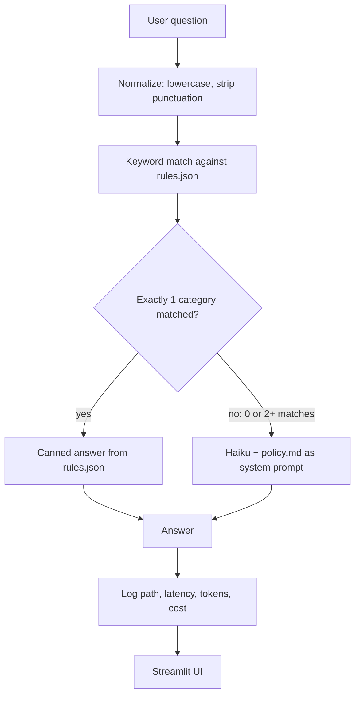

# Change Request FAQ Agent

**Problem.** People raising IT change requests keep asking the same policy questions (change types, lead times, CAB approval, emergency changes, documentation). Answering every one with an LLM works but costs money and about 1.2 s per answer. This agent answers known questions instantly from keyword rules and sends everything else to Claude Haiku, grounded in a one-page synthetic change policy. Every answer logs its path, latency, tokens and cost, and a hand-graded eval compares the hybrid router with an all-LLM baseline.



## Headline result

On 14 **new** questions the rules were never tuned on (the holdout), every answer graded by hand (Y = 1, P = 0.5, N = 0):

| Holdout, 14 questions | Router (rules first, LLM fallback) | All-LLM |
|---|---|---|
| Answered by rules | 36% (5/14) | 0% |
| Useful answers | **57%** | **89%** |
| Cost per question | $0.00107 | $0.00168 |
| **Cost per useful answer** | **$0.00188** | **$0.00188** |
| Avg latency (all answers) | 847 ms | 1,338 ms |
| p95 latency (LLM answers) | 1,696 ms | 1,735 ms |
| Projected cost per 10,000 questions | $10.74 | $16.79 |

**The router looks 36% cheaper, but per useful answer it costs exactly the same.** The saving came from handing out unhelpful canned answers for free: 4 of the 5 rule answers were not useful, and in each of those 4 cases the LLM answered the question.

On the 26 **seen** questions the rules were written against, the router looks much better (rules answer 77% with the right category 20/20, $3.65 vs $15.94 per 10,000 questions), but even there rule answers were graded 68% useful vs 100% for the LLM (20 of 26 questions graded).

<details>
<summary>Full results: both modes x both question sets</summary>

Source: `python day06\eval.py` (80 rows: 40 questions x 2 modes), graded by hand in `day06\results.csv`, summarized by `python day06\summarize.py` into `day06\summary.md`. "seen" = the 26 questions in `day03\faqs.json`; "holdout" = 14 questions in `day04\holdout.json` written without looking at the rules. `router` = rules first, LLM fallback; `all_llm` = every question to Haiku.

### router / seen

Questions: 26 | answered by rules: 77% | rule precision (right category): 20/20 (100%) | blended cost / question: $0.000365 | projected per 10,000 questions: $3.65

| Metric | Rule | LLM | All |
|---|---|---|---|
| Answers | 20 | 6 | 26 |
| Graded | 14/20 | 6/6 | 20/26 |
| Useful rate | 68% | 100% | 78% |
| Avg latency (ms) | 0 | 1,130 | 261 |
| p95 latency (ms) | 0 | 1,545 | 1,461 |
| Avg cost / answer | $0.000000 | $0.001581 | $0.000365 |

### router / holdout

Questions: 14 | answered by rules: 36% | rule precision (right category): 4/5 (80%) | blended cost / question: $0.001074 | projected per 10,000 questions: $10.74

| Metric | Rule | LLM | All |
|---|---|---|---|
| Answers | 5 | 9 | 14 |
| Graded | 5/5 | 9/9 | 14/14 |
| Useful rate | 10% | 83% | 57% |
| Avg latency (ms) | 0 | 1,318 | 847 |
| p95 latency (ms) | 0 | 1,696 | 1,696 |
| Avg cost / answer | $0.000000 | $0.001671 | $0.001074 |

### all_llm / seen

Questions: 26 | answered by rules: 0% | blended cost / question: $0.001594 | projected per 10,000 questions: $15.94

| Metric | LLM |
|---|---|
| Answers | 26 |
| Graded | 20/26 |
| Useful rate | 100% |
| Avg latency (ms) | 1,133 |
| p95 latency (ms) | 1,785 |
| Avg cost / answer | $0.001594 |

### all_llm / holdout

Questions: 14 | answered by rules: 0% | blended cost / question: $0.001679 | projected per 10,000 questions: $16.79

| Metric | LLM |
|---|---|
| Answers | 14 |
| Graded | 14/14 |
| Useful rate | 89% |
| Avg latency (ms) | 1,338 |
| p95 latency (ms) | 1,735 |
| Avg cost / answer | $0.001679 |

Notes: p95 is nearest-rank (with fewer than 20 answers it is effectively the maximum). Costs use Haiku 4.5 prices from `day04/router.py`; the 10,000-question projection assumes the same rules/LLM mix as the test set.

</details>

## What I found

- **Rules look great on questions they were tuned on and poorly on new ones.** Seen set: rules answered 77% with the right category every time. Holdout: rules answered 36%, and only 10% of those answers were useful.
- **Right category does not mean helpful.** On the holdout the rules picked the expected category 4 times out of 5, but a canned paragraph about the right *topic* rarely answered the actual *question* (hd-05: "which risk level should I select?", hd-08: "whom do I inform if I overrun the window?", hd-13: "my change is missing from today's CAB agenda").
- **Cost per useful answer is the metric that matters.** Router and all-LLM both cost $0.00188 per useful answer on the holdout. Counting only cost per question would have made the router look like a 36% saving.
- **Rules work for narrow intents with one fixed answer.** The out-of-scope redirects (payroll, email password) were useful 2/2 at $0 and 0 ms.
- **Keyword rules misfire on unseen phrasing.** hd-11 ("a team member made a change beyond the approved scope of the change request") matched only the phrase `change request` and got the CR-form paragraph: wrong category, not useful. Separately, the `when ... submit` pattern added on Day 4 to pass faq-26 sent a live test question ("what all details needed when i am submitting a standard change?") to lead times instead of documentation. Both were instant, free and confidently wrong.
- **Grounding mostly held, with two minor slips.** LLM answers stayed within the policy and said so when it did not cover a question (hd-01, hd-03, hd-09, hd-10). Two slips: faq-16 says all mandatory fields are on the Plan tab (the policy puts only the backout plan there), and hd-12 refers to "the policy document above", which is the system prompt the user cannot see.
- **The LLM was repeatable in this run.** Every question that went to the LLM in both modes got identical answer text at temperature 0 (only latency differed), although faq-02's output length changed between earlier runs. A response cache for repeated questions would be a cheaper, higher-quality "rule" than keyword matching.
- **Test-set quality matters.** 20/20 on 20 easy Claude-written questions hid weaknesses; harder, real-phrased questions dropped classification accuracy to 24/26 (Day 4), and rules written while looking at the test questions overfit.

## When should you use rules instead of an LLM?

Use rules for narrow, high-volume questions that have exactly one stable answer, like "this is out of scope, contact HR". There they were 100% useful, free and instant. Don't use broad topic rules: on new questions they picked the right topic 80% of the time but helped only 10% of the time, and per useful answer they saved nothing compared with sending everything to the LLM. Every rule also has an owner cost: it copies the policy, has to change when the policy changes, and fails silently when it misfires, so rules belong under change control with a regression test. Forecast cost on unseen questions (holdout), not on the questions the rules were tuned on, and promote a question to a rule only after the logs show it is frequent and its answer never varies.

## What I would do next

- Replace topic-level keyword rules with a few intent-level rules (one question, one answer), or drop rules except out-of-scope.
- Add a response cache for exact repeat questions and prompt caching for the policy (about 1,270 of ~1,280 input tokens per LLM call).
- Fix the `when ... submit` and `change request` patterns, move the misfired questions into the regression set, and re-test on fresh holdout questions (before/after).
- Replace hand grading with an LLM-as-judge, calibrated against these hand grades (Week 3).

## How to run

From the `change-request-faq-agent` folder in PowerShell (the venv and `.env` sit one and two levels up):

```powershell
..\..\.venv\Scripts\Activate.ps1
pip install -r ..\requirements.txt
# put ANTHROPIC_API_KEY=<your key> in a git-ignored .env file in the repo root (ai-builder-portfolio)

streamlit run day05\app.py              # the FAQ app
python day04\router.py                  # route the 26 seen questions, writes day04\router_log.csv
python day06\eval.py                    # eval: asks to confirm; --yes skips (~55 Haiku calls, ~$0.09)
# grade the `useful` column of day06\results.csv by hand: Y / P / N
python day06\summarize.py               # writes day06\summary.md
```

## Known issues

- Broad keyword rules misfire on unseen phrasing (hd-11, `when ... submit`). The rules count keywords; they do not understand meaning.
- Rules give one canned answer per category, so a right-category answer can miss the actual question.
- Some questions need live data, not a FAQ: hd-01 (find conflicting planned changes) and hd-09 (list tonight's approved changes) need a change-calendar lookup, a tool planned for Week 4.
- LLM cost is dominated by the policy sent with every call; prompt caching is not used yet.
- The test set is small (26 seen + 14 holdout), partly written by Claude, and the seen questions shaped the rules. With 14 holdout questions, one grade moves the useful rate by about 7 points.
- Usefulness was graded by one person (me). Rubric used: an honest "the policy doesn't cover this" counts as useful only if it points the user somewhere (hd-01, hd-09 = Y; hd-03 = N).
- 12 eval rows (faq-10 to faq-15, both modes) are not yet graded, so seen-set useful rates cover 20 of 26 questions. The holdout is fully graded.
- Self-reported LLM confidence was a weak signal in the Day 3-4 classifier tests, so no confidence threshold is used.

## Folder layout

The `dayNN` folders are the build steps in order, kept as a learning trail: `day01` token estimate, `day02` first API call, `day03` JSON classifier (prompt vs structured outputs), `day04` rules-vs-LLM router and holdout, `day05` Streamlit app, `day06` evaluation and summary.
